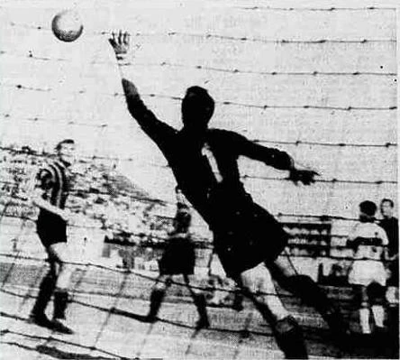

![Fase di gioco della storica vittoria per 2-0 contro l'Inter di Helenio Herrera ([[07-media-e-comunicazione/firme-e-voci/clamoroso-al-cibali|Clamoroso al Cibali]]!)](/assets/images/partite-storiche/catania-inter-2-0-clamoroso-al-cibali-serie-a-1960-1961.webp)

# Catania - Inter 2-0 (4 Giugno 1961)

La sfida **Catania-Inter (2-0)** disputata il **4 giugno 1961** allo [[stadio/angelo-massimino|Stadio Cibali]] per la 34ª e ultima giornata della Serie A 1960-1961 è entrata nella storia della lingua e del costume italiano grazie alla celebre esclamazione radiofonica **_[[07-media-e-comunicazione/firme-e-voci/clamoroso-al-cibali|Clamoroso al Cibali]]_** attribuita a **Sandro Ciotti** (in collegamento con Enrico Ameri su *Tutto il calcio minuto per minuto*), divenuta per antonomasia sinonimo di un ribaltamento di pronostico inatteso e sensazionale.

> [!quote] Il Contesto Storico della Gara
> Alla vigilia dell'ultimo turno, l'Inter di Helenio Herrera necessitava di una vittoria a Catania per tenere vive le speranze di Scudetto nel testa a testa con la Juventus, mentre il neopromosso **Club Calcio Catania** del presidente **Ignazio Marcoccio** e dell'allenatore **Carmelo Di Bella** aveva già ampiamente blindato la salvezza ma onorò il campionato con una prestazione memorabile, chiudendo al **8º posto con 36 punti**.

---

## Tabellino Ufficiale dell'Incontro

| Dati Gara | Dettaglio Ufficiale Certificato |
| :--- | :--- |
| **Data e Ora** | Domenica 4 giugno 1961, ore 16:30 |
| **Impianto** | [[stadio/angelo-massimino\|Stadio Cibali]], Catania (ca. 25.000 spettatori) |
| **Arbitro** | Cesare Jonni della sezione AIA di Macerata |
| **Marcatori** | **25' Castellazzi** (Catania), **70' Calvanese** (Catania) |
| **Formazione Catania** | Gaspari; Michelotti, Giavara; Corti, Grani, Ferretti; Castellazzi, Biagini, Calvanese, Prenna, Morelli. — **All.:** Carmelo Di Bella. |
| **Formazione Inter** | Buffon; Picchi, Giacomazzi; Bolchi, Guarneri, Balleri; Bicicli, Lindskog, Firmani, Corso, Morbello. — **All.:** Helenio Herrera. |

---

## Fonti e Bibliografia

1. **Antonio Buemi, Carlo Fontanelli, Roberto Quartarone, Alessandro Russo, Filippo Solarino**, *Tutto il Catania minuto per minuto (1929–2010)*, GEO Edizioni, Empoli, 2010, Capitolo Stagione 1960-1961.
2. **[Teche RAI](https://www.teche.rai.it/)**, *Tutto il calcio minuto per minuto*, puntata del 4 giugno 1961 (radiocronaca dallo Stadio Cibali di Sandro Ciotti).
3. **Archivio Storico La Sicilia**, *Catania-Inter 2-0: apoteosi rossazzurra al Cibali*, edizione del 5 giugno 1961.