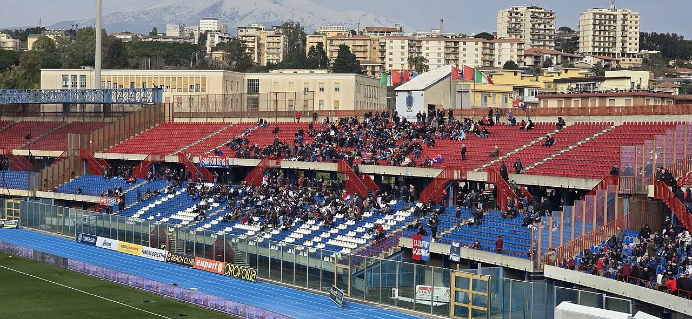

# Catania-Roma 1-1 (18 Maggio 2008)

La sfida del **18 maggio 2008** tra Catania e Roma rappresenta uno dei capitoli pi carichi di tensione emotiva e gioia collettiva della storia rossazzurra. All'ultima giornata di campionato la Roma di Spalletti si gioca lo scudetto contro l'Inter, mentre il Catania di [[tesserati/allenatori/walter-zenga|Walter Zenga]] deve fare punti per evitare la retrocessione in Serie B.

## Cronaca della Partita
All'8' minuto i giallorossi sbloccano la gara con una prodezza di Mirko Vucinic, gelando il Massimino mentre giungono notizie del vantaggio dell'Inter a Parma. Il Catania reagisce con coraggio e all'85', su cross pennellato e mischia in area, l'uruguaiano **Jorge Andrs Martnez** calcia al volo battendo Doni: un gol storico che sigilla l'1-1 finale e garantisce la permanenza aritmetica in Serie A tra il delirio dei 21.000 tifosi etnei.

## Collegamenti Correlati
* [[stagioni/2007-2008|Stagione 2007-2008]]
* [[tesserati/allenatori/walter-zenga|Walter Zenga]]
* [[stadio/angelo-massimino|Stadio Angelo Massimino]]

## Fonti e Bibliografia
* Antonio Buemi, Carlo Fontanelli, Roberto Quartarone, Alessandro Russo, Filippo Solarino, *Tutto il Catania minuto per minuto*, GEO Edizioni, Empoli, 2010.
* *Almanacco Illustrato del Calcio*, Panini Edizioni, Modena.
* [CalcioCatania.com](https://www.calciocatania.com/) — Archivio storico e statistiche ufficiali.
