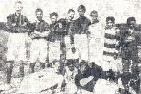

# Stagione 1929-1930 (Seconda Divisione)

*La prima storica formazione della Societ Sportiva Catania schierata al Campo dei Due Obelischi nel 1929 — Licenza: Pubblico Dominio Italia (Art. 92 L. 633/1941 - >20 anni) — Crediti: Archivio Storico Calcio Catania*

Il 14 settembre 1929 è l'inizio di una storia rossazzurra, il Catania viene inserito nel girone A del campionato di Seconda Divisione Sud, con squadre campane, calabresi ed il Peloro Messina. La squadra etnea chiude la stagione d'esordio al nono e penultimo posto della classifica con 10 punti. La stagione 1929-1930 è quella della svolta del calcio italiano, nascono la "Serie A" e la "Serie B". Anche il Catania inizia l'avventura nel calcio che conta e conclude la stagione al nono posto, davanti alla Puteolana che retrocede.

Con la maglia "rosso lava dell'Etna e azzurro cielo", il Catania nella sua prima stagione ufficiale disputa le partite interne sul Campo del Dopolavoro Ferroviario. La prima volta è sempre particolare, c'è entusiasmo, finalmente una città di 250.000 abitanti si mette al passo col resto d'Italia, dove da decenni il calcio ha sfondato. Ma ci sono anche molti rovesci, la prima stagione si chiude con 4 vittorie, 2 pareggi e ben 12 sconfitte.

In vetta Paganese e Reggina conquistano l'accesso al girone finale per la promozione, e proprio i calabresi riusciranno a salire, vincendo il titolo di campioni della Seconda Divisione Sud. La stagione fa accumulare esperienza ai dirigenti etnei, che si confrontano per la prima volta con i campionati ufficiali della Federazione, dopo le fugaci apparizioni dei primi anni venti.

---

## Organigramma Societario e Staff Tecnico

| Ruolo | Nominativo / Riferimento | Note Istituzionali |
| :--- | :--- | :--- |
| **Ragione Sociale** | [[societa/1929-ss-catania|Società Sportiva Catania / AFC Catania (1929-1943)]] | Matricola FIGC N/A (Pre-1946) |
| **Presidente** | [[societa/presidenti/santi-quasimodo|Santi Quasimodo]] | Presidenza e rappresentanza sociale |
| **Allenatore** | [[tesserati/allenatori/giorgio-armari|Giorgio Armari]] | Conduzione tecnica della prima squadra |
| **Impianto Ufficiale** | [[stadio/piazza-esposizione|Campo Piazza Esposizione]] | Campo interno di gioco |

---

## Rosa Calciatori e Marcatori Stagionali

| Calciatore | Ruolo | Note Tecniche |
| :--- | :---: | :--- |
| **Piero Blengino** | Attaccante | Rosa ufficiale |
| **Mario Canarelli** | Portiere | Rosa ufficiale |
| **Cifarelli** | Difensore | Rosa ufficiale |
| **Andrea D'Amelio** | Difensore | Rosa ufficiale |
| **Francesco Di Leo** | Attaccante | Rosa ufficiale |
| **Calogero Di Maira** | Portiere | Rosa ufficiale |
| **Giovanni Di Mino** | Centrocampista | Rosa ufficiale |
| **Antonino Foti** | Attaccante | Rosa ufficiale |
| **Giovanni Gambadoro** | Centrocampista | Rosa ufficiale |
| **Giuseppe Giacobbe** | Difensore | Rosa ufficiale |
| **Pietro Leonardi** | Centrocampista | Rosa ufficiale |
| **Antonino Messina** | Centrocampista | Rosa ufficiale |
| **Doma Mustafà** | Difensore | Rosa ufficiale |
| **Manfredi Paolillo** | Attaccante | Rosa ufficiale |
| **Giovanni Piacentini** | Attaccante | Rosa ufficiale |

---

## Risultati Partita per Partita (Campionato)

| Giornata | Data | Incontro | Ris. | Esito | Marcatori Rossazzurri | Marcatori Avversari | Note / Stadio |
| :--- | :--- | :--- | :---: | :---: | :--- | :--- | :--- |
| 1ª giornata | 27 ottobre 1929 | Catania – Reggina | 0–7 | **P** | — | — | Campo Dopolavoro Ferroviario · Arb: Antonio Starvaggi |
| 2ª giornata | 3 novembre 1929 | Catania – Cosenza | 1–4 | **P** | — | — | Campo Dopolavoro Ferroviario · Arb: Umberto Gagliardi |
| 3ª giornata | 10 novembre 1929 | Gladiator – Catania | 1–0 | **P** | — | — | Campo di Piazza Berolasi · Arb: Beniamino De Sanctis |
| 4ª giornata | 17 novembre 1929 | Catania – Nola | 0–3 | **P** | — | — | Campo Dopolavoro Ferroviario · Arb: Mastracchio |
| 5ª giornata | 24 novembre 1929 | Cotoniere Angri – Catania | 7–0 | **P** | — | — | Campo Comunale · Arb: Generoso Dattilo |
| 6ª giornata | 8 dicembre 1929 | Paganese – Catania | 5–0 | **P** | — | — | Campo del Pino · Arb: Armando Bonifazi |
| 7ª giornata | 15 dicembre 1929 | Puteolana – Catania | 0–2 | **V** | — | — | — |
| 8ª giornata | 22 dicembre 1929 | Catania – US Bagnolese | 0–4 | **P** | — | — | Campo Dopolavoro Ferroviario · Arb: Pasquale Barone |
| 9ª giornata | 29 dicembre 1929 | Peloro – Catania | 6–0 | **P** | — | — | Campo di Portalegni · Arb: Pasquale Barone |
| 10ª giornata | 5 gennaio 1930 | Reggina – Catania | 11–0 | **P** | — | — | Campo Sant'Anna · Arb: Umberto Gagliardi |
| 11ª giornata<ref>Partita rinviata e recuperata il 16 marzo 1930.</ref> | 12 gennaio 1930 | Cosenza – Catania | 3–0 | **P** | — | — | Stadio Città di Cosenza · Arb: Giuseppe Salvatori |
| 12ª giornata | 19 gennaio 1930 | Catania – Gladiator | 2–2 | **N** | — | — | Campo Dopolavoro Ferroviario · Arb: Attilio Ferro |
| 13ª giornata | 26 gennaio 1930 | Nola – Catania | 4–0 | **P** | — | — | Campo di Piazza D'Armi · Arb: Francesco Binetti |
| 14ª giornata | 2 febbraio 1930 | Catania – Cotoniere Angri | 2–2 | **N** | — | — | Campo Dopolavoro Ferroviario · Arb: Mastracchio |
| 15ª giornata | 9 febbraio 1930 | Catania – Paganese | 0–1 | **P** | — | — | Campo Dopolavoro Ferroviario · Arb: Antonio Stravaggi |
| 16ª giornata | 16 febbraio 1930 | Catania – Puteolana | 7–1 | **V** | — | — | Campo Dopolavoro Ferroviario · Arb: Pasquale Barone |
| 17ª giornata | 23 febbraio 1930 | US Bagnolese – Catania | 0–2 | **V** | — | — | — |
| 18ª giornata | 9 marzo 1930 | Catania – Peloro | 5–1 | **V** | — | — | Campo Dopolavoro Ferroviario · Arb: Grazio Siino |

---

## Classifica Finale e Verdetti Ufficiali

Il Catania ha concluso il campionato di **Seconda Divisione** al **9°** con **10 punti** all'attivo.

| Pos. | Squadra | G | V | N | P | GF | GS | Pt | Verdetto Ufficiale |
| :---: | :--- | :---: | :---: | :---: | :---: | :---: | :---: | :---: | :--- |
| **9.** | **[[societa/1929-ss-catania|Società Sportiva Catania / AFC Catania (1929-1943)]]** | **18** | **4** | **2** | **12** | **21** | **62** | **10** | **9° (Seconda Divisione)** |

---

## Verifica Metodologica e Statistica

<strong>Sintesi Statistica e Quadratura Algebrica</strong> (clicca per visualizzare i dettagli di calcolo)

- **Bilancio Campionato:** 18 G | 4 V | 2 N | 12 P | 21 GF | 62 GS | Diff. reti -41
- **Quadratura Punti (Regime 2 pt/vittoria):** $(4 \times 2) + 2 - 0\text{ (pen.)} = \mathbf{10\text{ punti}}$ (9° finale in Seconda Divisione).
- **Capocannoniere di Squadra:** **Blengino** con **7 reti**.
- **Impianto Ufficiale:** [[stadio/piazza-esposizione|Campo Piazza Esposizione]].

## Fonti e Bibliografia
* **Wikipedia Italia**, *[Monografia Ufficiale — Società Sportiva Catania 1929-1930](https://it.wikipedia.org/wiki/Societ%C3%A0_Sportiva_Catania_1929-1930)*.

1. **Antonio Buemi, Carlo Fontanelli, Roberto Quartarone, Alessandro Russo, Filippo Solarino**, *Tutto il Catania minuto per minuto (1929–2010)*, GEO Edizioni, Empoli, 2010 (Sezione Stagione 1929-1930).
2. **Federazione Italiana Giuoco Calcio (FIGC)**, *Annuario Ufficiale del Calcio Italiano*, Roma.
3. **Archivio Storico Mimmo Rapisarda**, *Campionato 1929-1930: tabellini e statistiche*, [mimmorapisarda.it](https://www.mimmorapisarda.it/).