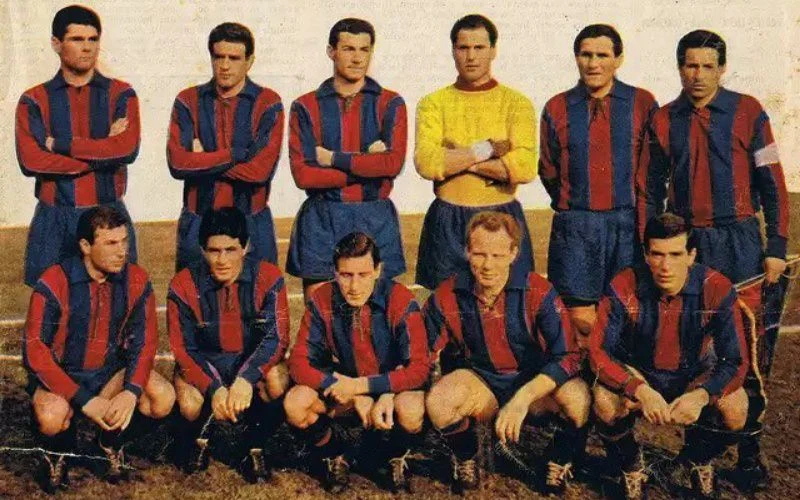

# Stagione 1953-1954 (Serie B)

*Formazione ufficiale del Calcio Catania vincitrice della Serie B 1953-1954 e promossa in Serie A — Licenza: Pubblico Dominio Italia (Art. 92 L. 633/1941 - >20 anni) — Crediti: Archivio Storico Calcio Catania*

La **Stagione 1953-1954** consegna per la prima volta nella storia il [[societa/1946-club-calcio-catania|Club Calcio Catania]] all'Olimpo della **Serie A**. Dopo lo spareggio promozione perso l'anno precedente a Firenze contro il Legnano (4-1), la società rossazzurra conferma in panchina il tecnico [[tesserati/allenatori/piero-andreoli|Piero Andreoli]] e costruisce un collettivo granitico capace di dominare il torneo cadetto a 18 squadre, conquistando il **1º posto assoluto con 43 punti** e il miglior attacco del campionato (54 reti all'attivo) sul prato dello [[stadio/angelo-massimino|Stadio Cibali]].

## Organigramma Societario e Staff Tecnico

| Ruolo | Nominativo / Riferimento | Note Storiche |
| :--- | :--- | :--- |
| **Ragione Sociale** | [[societa/1946-club-calcio-catania\|Club Calcio Catania]] | Matricola FIGC 11700 |
| **Vertice Societario** | Giuseppe Rizzo e Arturo Michisanti | Commissari e reggenti finanziari del Club Calcio Catania |
| **Direttore Sportivo / Sett. Giovanile** | [[tesserati/allenatori/carmelo-di-bella\|Carmelo Di Bella]] (Sett. Giovanile) | Coordinamento tecnico e organizzativo |
| **Allenatore** | [[tesserati/allenatori/piero-andreoli\|Piero Andreoli]] | Dalla 1ª alla 34ª giornata (Promosso in Serie A) |
| **Capitano** | Nicola Fusco | Bandiera e leader della mediana rossazzurra |
| **Impianto Interno** | [[stadio/angelo-massimino\|Stadio Cibali]] | Imbattuto per 16 gare su 17 incontri casalinghi |

---

## Rosa Principale e Statistiche Marcatori

Il capolavoro tattico di [[tesserati/allenatori/piero-andreoli|Piero Andreoli]] si fonda sulla cerniera difensiva guidata dal portiere Antonio Seveso e dai terzini Varoli e Bravetti, sull'instancabile filtro di Bearzot (futuro Commissario Tecnico Campione del Mondo 1982), Fusco e Santamaria, e sull'estro realizzativo di Michele Manenti, Guido Klein, Vittorio Ghiandi e dell'olimpionico danese Karl Aage Hansen.

| Calciatore | Ruolo | Presenze | Reti Campionato | Note |
| :--- | :---: | :---: | :---: | :--- |
| **Michele Manenti** | Ala / Mezzala | 34 | **15** | Capocannoniere stagionale rossazzurro |
| **Guido Klein** | Mezzala | 31 | **12** | Determinante negli inserimenti offensivi |
| **Vittorio Ghiandi** | Centravanti | 25 | **10** | Acquistato in autunno, decisivo nel girone di ritorno |
| **Karl Aage Hansen** | Interno / Regista offensivo | 27 | **6** | Ex Juventus e Sampdoria, faro tecnico della manovra |
| **Francesco Bassetti** | Ala | 22 | **5** | — |
| **Nicola Fusco** | Mediano (Capitano) | 31 | **3** | Leader carismatico dello spogliatoio |
| **Enzo Bearzot** | Mediano / Centrovasca | 34 | **1** | Stacanovista sempre presente (34 gare su 34) |
| **Antonio Seveso** | Portiere | 34 | **0** | 31 reti subite in 34 giornate |
| **Ezio Varoli** | Terzino | 33 | **0** | Colonna del reparto arretrato |

---

## Risultati Chiave, Partite Storiche e Cammino in Campionato

Dopo un avvio equilibrato, l'innesto autunnale del centravanti **Vittorio Ghiandi** cambia il volto dell'attacco etneo. Il Catania infila una serie impressionante di risultati positivi, vincendo il [[tifoseria/rivalita/messina|derby col Messina]] sia all'andata allo [[stadio/angelo-massimino|Stadio Cibali]] (2-1) sia al ritorno al "Celeste" (0-1 con rete di Manenti). La matematica certezza della **prima promozione in Serie A** arriva con due turni d'anticipo, il **16 maggio 1954**, espugnando il campo del **Brescia per 0-2** grazie alle reti di Klein e Manenti.

| Data | Giornata | Incontro | Risultato | Marcatori Rossazzurri |
| :--- | :--- | :--- | :---: | :--- |
| **1º novembre 1953** | 8ª Giornata Serie B | **Catania - Messina** | **2-1** | Klein (19'), Hansen (62') |
| **13 dicembre 1953** | 13ª Giornata Serie B | **Catania - Lanerossi Vicenza** | **2-1** | Manenti (34'), Ghiandi (78') — *Vetta della classifica* |
| **21 marzo 1954** | 25ª Giornata Serie B | **Messina - Catania** | **0-1** | Manenti (68') — *Trionfo esterno nel derby dello Stretto* |
| **2 maggio 1954** | 31ª Giornata Serie B | **Catania - Cagliari** | **3-1** | Doppietta di Ghiandi, Klein |
| **16 maggio 1954** | 32ª Giornata Serie B | **Brescia - Catania** | **0-2** | Klein (22'), Manenti (84') — **Matematica Promozione in Serie A** |
| **23 maggio 1954** | 33ª Giornata Serie B | **Catania - Pro Patria** | **2-0** | Ghiandi (15'), Manenti (60') — *Festa del 1º posto al Cibali* |

---

## Classifica Finale e Verdetti del Torneo

| Pos. | Squadra | Pt | G | V | N | P | GF | GS | DR | Verdetto |
| :---: | :--- | :---: | :---: | :---: | :---: | :---: | :---: | :---: | :---: | :--- |
| **1.** | **[[societa/1946-club-calcio-catania\|Club Calcio Catania]]** | **43** | **34** | **16** | **11** | **7** | **54** | **31** | **+23** | **Promosso in Serie A (1º Titolo Cadetto)** |
| 2. | Pro Patria | 41 | 34 | 15 | 11 | 8 | 49 | 36 | +13 | Promossa in Serie A dopo spareggio col Cagliari |
| 3. | Cagliari | 41 | 34 | 16 | 9 | 9 | 42 | 30 | +12 | Perde lo spareggio promozione |
| 4. | Como | 40 | 34 | 14 | 12 | 8 | 37 | 22 | +15 | — |
| 5. | Marzotto Valdagno | 39 | 34 | 15 | 9 | 10 | 39 | 30 | +9 | — |
| 6. | Lanerossi Vicenza | 37 | 34 | 13 | 11 | 10 | 41 | 34 | +7 | — |

---

---

## Verifica Metodologica e Statistica

<strong>Sintesi Statistica e Quadratura Algebrica</strong> (clicca per visualizzare i parametri e la quadratura)

- **Bilancio Campionato:** 34 G | 16 V | 11 N | 7 P | 54 GF | 31 GS | Diff. reti +23
- **Quadratura Punti:** $(16 \times 2) + 11 - 0\text{ (pen.)} = \mathbf{43\text{ punti}}$ (**1º posto assoluto**, campione della Serie B 1953-1954 davanti alla Pro Patria a quota 41).
- **Capocannoniere:** **Michele Manenti** (15 reti in 34 presenze), seguito da Guido Klein (12 reti) e Vittorio Ghiandi (10 reti).

## Fonti e Bibliografia
* **Wikipedia Italia**, *[Monografia Ufficiale — Club Calcio Catania 1953-1954](https://it.wikipedia.org/wiki/Club_Calcio_Catania_1953-1954)*.

1. **Antonio Buemi, Carlo Fontanelli, Roberto Quartarone, Alessandro Russo, Filippo Solarino**, *Tutto il Catania minuto per minuto (1929–2010)*, GEO Edizioni, Empoli, 2010, pp. 142–148.
2. **Lega Nazionale FIGC**, *Almanacco e Classifica Ufficiale Serie B 1953-1954*, Milano, 1954.
3. **Archivio Storico Mimmo Rapisarda**, *Stagione 1953-1954: la cavalcata di Piero Andreoli verso la Serie A*, [mimmorapisarda.it](https://www.mimmorapisarda.it/).