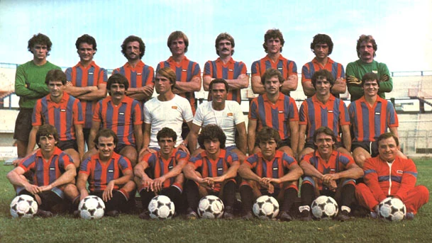

*[[03-tesserati/calciatori/archivio/d-f/ennio-mastalli|Ennio Mastalli]] e [[03-tesserati/calciatori/storici/aldo-cantarutti|Aldo Cantarutti]], protagonisti della promozione in Serie A conquistata a Roma negli spareggi del giugno 1983*

*La formazione del Calcio Catania protagonista dello spareggio promozione di Roma nel giugno 1983 — Licenza: Pubblico Dominio Italia (Art. 92 L. 633/1941 - >20 anni) — Crediti: Archivio Storico Calcio Catania*

# Stagione 1982-1983 (Serie B)

*Classifica finale di Serie B 1982-1983 con la qualificazione del Catania agli spareggi promozione dell'Olimpico — Licenza: Pubblico Dominio Italia (Art. 92 L. 633/1941 - >20 anni) — Crediti: Archivio Storico Calcio Catania*

Nella stagione 1982-1983 il Catania disputa il venticinquesimo campionato di Serie B della sua storia. Un campionato che ha riportato gli etnei in paradiso. Sabato 25 giugno 1983 a Roma davanti a 35.000 tifosi giunti dalla Trinacria, quando il fischietto romano Gianfranco Menegali giunto alla sua gara d’addio, alle ore 18 fischia la fine di Catania-Cremonese (0-0), secondo spareggio promozione, nel primo la squadra siciliana aveva superato (1-0) il Como, per la quarta volta nella sua storia il Catania sale in Serie A.
Il condottiero che ha guidato gli etnei alla promozione nel massimo campionato è il napoletano Gianni Di Marzio, terza classificata il Catania con Como e Cremonese a 45 punti, poi superate negli spareggi giocati a Roma, alle spalle di Milan e Lazio. Oltre alle 12 reti di Aldo Cantarutti delle quali 1 in Coppa Italia e 11 in campionato, decisivo l’ottimo torneo del faro di centrocampo Ennio Mastalli autore anche di 9 reti, di cui 5 su calcio di rigore, ma altra protagonista stagionale la difesa rossoazzurra, che con 21 reti subite è stata la migliore del campionato cadetto.
In Coppa Italia il Catania disputa prima del campionato il sesto girone di qualificazione, si piazza terzo con 6 punti, alle spalle di Juventus e Milan che accedono agli ottavi di finale della manifestazione.

---

## Organigramma Societario e Staff Tecnico

| Ruolo | Nominativo / Riferimento | Note Istituzionali |
| :--- | :--- | :--- |
| **Ragione Sociale** | [[01-societa/epoche/1967-calcio-catania-spa-massimino\|Calcio Catania S.p.A. — Era Massimino (1967-1993)]] | Matricola FIGC 11700 |
| **Presidente** | [[01-societa/presidenti/angelo-massimino\|Angelo Massimino]] | Presidenza e rappresentanza sociale |
| **Allenatore** | [[03-tesserati/allenatori/gianni-di-marzio\|Gianni Di Marzio]] | Conduzione tecnica della prima squadra |
| **Impianto Ufficiale** | [[04-strutture/stadio-massimino/angelo-massimino\|Stadio Cibali / Angelo Massimino]] | Campo interno di gioco |

---

## Rosa Calciatori e Marcatori Stagionali

| Calciatore | Ruolo | Note Tecniche |
| :--- | :---: | :--- |
| **[[03-tesserati/calciatori/storici/roberto-sorrentino\|Roberto Sorrentino]]** | Portiere | Rosa ufficiale |
| **[[03-tesserati/calciatori/archivio/m-o/marco-onorati\|Marco Onorati]]** | Portiere | Rosa ufficiale |
| **[[03-tesserati/calciatori/archivio/g-l/giacomo-chinellato\|Giacomo Chinellato]]** | Difensore | Rosa ufficiale |
| **[[03-tesserati/calciatori/archivio/d-f/francesco-ciampoli\|Francesco Ciampoli]]** | Difensore | Rosa ufficiale |
| **[[03-tesserati/calciatori/archivio/d-f/domenico-labrocca\|Domenico Labrocca]]** | Difensore | Rosa ufficiale |
| **[[03-tesserati/calciatori/archivio/s-z/vincenzo-marino\|Vincenzo Marino (1960)]] |Difensore | Rosa ufficiale |
| [[03-tesserati/calciatori/storici/giorgio-mastropasqua\|Giorgio Mastropasqua]] | Difensore | Rosa ufficiale |
| [[03-tesserati/allenatori/pier-giuseppe-mosti\|Pier Giuseppe Mosti]] | Difensore | Rosa ufficiale |
| [[03-tesserati/calciatori/archivio/p-r/rosario-picone\|Rosario Picone]] | Difensore | Rosa ufficiale |
| [[03-tesserati/calciatori/archivio/a-c/claudio-ranieri\|Claudio Ranieri]] | Difensore | Rosa ufficiale |
| [[03-tesserati/calciatori/archivio/p-r/roberto-barozzi\|Roberto Barozzi]] | Centrocampista | Rosa ufficiale |
| [[03-tesserati/calciatori/archivio/a-c/antonio-crusco\|Antonio Crusco]] | Centrocampista | Rosa ufficiale |
| [[03-tesserati/calciatori/archivio/m-o/marcello-gamberini\|Marcello Gamberini]] | Centrocampista | Rosa ufficiale |
| [[03-tesserati/calciatori/archivio/m-o/maurizio-giovannelli\|Maurizio Giovannelli]] | Centrocampista | Rosa ufficiale |
| Ennio Mastalli | Centrocampista | Rosa ufficiale |

---

## Risultati Partita per Partita (Campionato)

| Giornata | Data | Incontro | Ris. | Esito | Marcatori Rossazzurri | Marcatori Avversari | Note / Stadio |
| :--- | :--- | :--- | :---: | :---: | :--- | :--- | :--- |
| 1ª giornata | 12 settembre 1982 | Cremonese – Catania | 0–1 | V | 82’ Cantarutti | — | Stadio Giovanni Zini · Arb: Arcangelo Pezzella |
| 2ª giornata | 19 settembre 1982 | Catania – Milan | 1–1 | N | Mastalli 60’ (rig.) | 51’ (rig.) Baresi II | Stadio Cibali · Arb: Gianfranco Menegali |
| 3ª giornata | 26 settembre 1982 | Lecce – Catania | 0–1 | V | 33’ Cantarutti | — | Stadio Via del Mare · Arb: Pierluigi Magni |
| 4ª giornata | 3 ottobre 1982 | Catania – Reggiana | 0–0 | N | — | — | Stadio Cibali · Arb: Giorgio Baldi |
| 5ª giornata | 10 ottobre 1982 | Atalanta – Catania | 0–1 | V | 76’ Giovannelli | — | Stadio Comunale · Arb: Luigi Altobelli |
| 6ª giornata | 17 ottobre 1982 | Catania – Varese | 0–0 | N | — | — | Stadio Cibali · Arb: Liberato Esposito |
| 7ª giornata | 24 ottobre 1982 | Palermo – Catania | 0–0 | N | — | — | Stadio La Favorita · Arb: Angelo Angelelli |
| 8ª giornata | 31 ottobre 1982 | Cavese – Catania | 1–0 | P | — | Cupini 31’ | Stadio Comunale · Arb: Paolo Tubertini |
| 9ª giornata | 7 novembre 1982 | Catania – Pistoiese | 1–1 | N | Crialesi 26’ | 85’ Vincenzi | Stadio Cibali · Arb: Sergio De Marchi |
| 10ª giornata | 14 novembre 1982 | Campobasso – Catania | 0–0 | N | — | — | Stadio Giovanni Romagnoli · Arb: Roberto Bianciardi |
| 11ª giornata | 21 novembre 1982 | Catania – Bari | 3–0 | V | Crusco 10’; Cantarutti 70’; Mastropasqua 88’ | — | Stadio Cibali · Arb: Liberato Esposito |
| 12ª giornata | 28 novembre 1982 | Como – Catania | 1–0 | P | — | Nicoletti 25’ | Stadio Giuseppe Sinigaglia · Arb: Luigi Altobelli |
| 13ª giornata | 5 dicembre 1982 | Catania – Arezzo | 3–0 | V | Crialesi 30’; Cantarutti 44’, 75’ | — | Stadio Cibali · Arb: Arcangelo Pezzella |
| 14ª giornata | 12 dicembre 1983 | Catania – Sambenedettese | 1–1 | N | Mastalli 37’ | 50’ Adami | Stadio Cibali · Arb: Gennaro Testa |
| 15ª giornata | 19 dicembre 1982 | Bologna – Catania | 1–1 | N | 44’ Cantarutti | Russo 47’ | Stadio Comunale · Arb: Claudio Pieri |
| 16ª giornata | 2 gennaio 1982 | Catania – Monza | 2–0 | V | Crialesi 12’; Cantarutti 71’ | — | Stadio Cibali · Arb: Paolo Tubertini |
| 17ª giornata | 9 gennaio 1982 | Foggia – Catania | 0–0 | N | — | — | Stadio Pino Zaccheria · Arb: Renzo Vitali |
| 18ª giornata | 16 gennaio 1983 | Catania – Lazio | 1–1 | N | Mastalli 90’ (rig.) | 78’ Giordano | Stadio Cibali · Arb: Mario Facchin |
| 19ª giornata | 19 gennaio 1983 | Perugia – Catania | 1–1 | N | 35’ Ranieri | Pagliari II 21’ | Stadio Renato Curi · Arb: Giancarlo Redini |
| 20º giornata | 30 gennaio 1983 | Catania – Cremonese | 0–0 | N | — | — | Stadio Cibali · Arb: Benedetti |
| 21º giornata | 13 febbraio 1983 | Milan – Catania | 0–0 | N | — | — | Stadio Giuseppe Meazza · Arb: D’Elia |
| 22º giornata | 20 febbraio 1983 | Catania – Lecce | 2–0 | V | Bagnato 10’ (aut.); Cantarutti 30’ | — | Stadio Cibali · Arb: Pairetto |
| 23º giornata | 27 febbraio 1983 | Reggiana – Catania | 1–0 | P | Boito 35’ | — | Stadio Mirabello · Arb: Leni |
| 24º giornata | 6 marzo 1983 | Catania – Atalanta | 0–0 | N | — | — | Stadio Cibali · Arb: Polacco |
| 25º giornata | 13 marzo 1983 | Varese – Catania | 2–1 | P | Bongiorni 26’; Di Giovanni 37’ | 30’ (rig.) Mastalli | Stadio Franco Ossola · Arb: Pirandola |
| 26º giornata | 20 marzo 1983 | Catania – Palermo | 2–0 | V | Mastalli 39’ (rig.); Mosti 43’ | — | Stadio Cibali · Arb: Bianciardi |
| 27º giornata | 27 marzo 1983 | Catania – Cavese | 2–0 | V | Mastalli 25’; Barozzi 39’ | — | Stadio Cibali · Arb: Pieri |
| 28º giornata | 2 aprile 1983 | Pistoiese – Catania | 1–0 | P | — | Bartolini 64’ | Stadio Comunale · Arb: Barbaresco |
| 29º giornata | 10 aprile 1983 | Catania – Campobasso | 1–0 | V | Ciampoli 59’ | — | Stadio Cibali · Arb: Patrussi |
| 30º giornata | 17 aprile 1983 | Bari – Catania | 1–0 | P | Caricola II 61’ | — | Stadio della Vittoria · Arb: Redini |
| 31º giornata | 24 aprile 1983 | Catania – Como | 0–0 | N | — | — | Stadio Cibali · Arb: Menicucci |
| 32º giornata | 1º maggio 1983 | Arezzo – Catania | 2–2 | N | Traini 2’; Belluzzi 61’ | 37’, 65’ Cantarutti | Stadio Comunale · Arb: Tubertini |
| 33º giornata | 8 maggio 1983 | Sambenedettese – Catania | 1–3 | V | Colasanti 80’ | 57’ (aut.) Cagni; 77’ Mosti; 89’ Mastalli | Stadio Fratelli Ballarin · Arb: Pairetto |
| 34º giornata | 15 maggio 1983 | Catania – Bologna | 2–1 | V | Crusco 71’; Barozzi 81’ | 47’ (aut.) Mastalli | Stadio Cibali · Arb: Angelelli |
| 35º giornata | 22 maggio 1983 | Monza – Catania | 0–0 | N | — | — | Stadio Gino Alfonso Sada · Arb: Vitali |
| 36º giornata | 29 maggio 1983 | Catania – Foggia | 2–1 | V | Crialesi 65’; Barozzi 67’ | 80’ (rig.) Bordon | Stadio Cibali · Arb: Agnolin |
| 37º giornata | 5 giugno 1983 | Lazio – Catania | 2–1 | P | 25’ Crialesi | Giordano 12’; Mastropasqua 65’ | Stadio Olimpico · Arb: Menicucci |
| 38º giornata | 14 giugno 1983 | Catania – Perugia | 2–1 | V | Cantarutti 60’; Mastalli 64’ | 34’ Amenta | Stadio Cibali · Arb: Pieri |
| Spareggio 1 | 18 giugno 1983 | Catania – Como | 1–0 | V | Crialesi 70’ | — | Stadio Olimpico · Arb: Agnolin |
| Spareggio 2 | 25 giugno 1983 | Catania – Cremonese | 0–0 | N | — | — | Stadio Olimpico · Arb: Menegali |
| 1º giornata | 18 agosto 1982 | Catania – Juventus | 1–1 | N | Mastropasqua 1’ | 52’ Marocchino | Stadio Cibali · Arb: Redini |
| 2º giornata | 22 agosto 1982 | Catania – Genoa | 1–0 | V | Crialesi 85’ | — | Stadio Cibali · Arb: Altobelli |
| 3º giornata | 29 agosto 1982 | Milan – Catania | 2–1 | P | 42’ (rig.) Mastalli | Jordan 44’; Serena 49’ | Stadio Galleana · Arb: Mattei |
| 4º giornata | 1º settembre 1982 | Catania – Padova | 2–1 | V | Cantarutti 45’; Crialesi 63’ | 11’ Pezzato | Stadio Cibali · Arb: Esposito |
| 5º giornata | 5 settembre 1982 | Pescara – Catania | 1–1 | N | 62’ Marino | Massi 55’ | Stadio Adriatico · Arb: Ciulli |

---

## Classifica Finale e Verdetti Ufficiali

Il Catania ha concluso il campionato di Serie B al 3º (promosso in Serie A) con 45 punti all'attivo.

| Pos. | Squadra | G | V | N | P | GF | GS | Pt | Verdetto Ufficiale |
| :---: | :--- | :---: | :---: | :---: | :---: | :---: | :---: | :---: | :--- |
| 3. | [[01-societa/epoche/1967-calcio-catania-spa-massimino\|Calcio Catania S.p.A. — Era Massimino (1967-1993)]]** | **38** | **14** | **17** | **7** | **37** | **21** | **45** | **3º (promosso in Serie A) (Serie B)** |

> **Competizioni Ufficiali Extra-Campionato:** Spareggi promozione (2G: 1V 1N 0P, 1:0); Coppa Italia (5G: 2V 2N 1P, 6:5). **Totale Gare Ufficiali Stagionali:** **45 G** (17 V, 20 N, 8 P; 44 GF, 26 GS).

---

## Movimenti Ufficiali di Calciomercato

### Sessione In Entrata (Acquisti e Rientri)

| Giocatore | Ruolo | Età | Club di Provenienza | Formula / Costo |
| :--- | :--- | :---: | :--- | :--- |
| Ennio Mastalli | Centrocampista | 23 | Varese | 750 mila € |
| Claudio Ranieri | Terzino destro | 30 | Catanzaro | ? |
| Maurizio Giovannelli | Centrocampo | 24 | Avellino | ? |
| Roberto Barozzi | Centrocampo | 22 | Cavese | ? |
| Giorgio Mastropasqua | Libero | 30 | Lazio | ? |
| Domenico Labrocca | Terzino destro | 29 | Siracusa | ? |
| Giacomo Chinellato | Difensore centrale | 27 | Cavese | ? |
| Antonio Crusco | Ala sinistra | 24 | Cavese | ? |
| [[03-tesserati/calciatori/archivio/m-o/mirco-paganelli\|Mirco Paganelli]] | Centrocampo | 22 | Pistoiese | ? |
| Vincenzo Marino | Difesa | 22 | Lecce | ? |
| Marco Onorati | Portiere | 18 | Roma | ? |

### Sessione In Uscita (Cessioni e Prestiti)

| Giocatore | Ruolo | Età | Club di Destinazione | Formula / Costo |
| :--- | :--- | :---: | :--- | :--- |
| [[03-tesserati/calciatori/archivio/a-c/andrea-pazzagli\|Andrea Pazzagli]] | Portiere | 22 | Bologna | ? |
| [[03-tesserati/allenatori/lorenzo-barlassina\|Lorenzo Barlassina]] | Attacco | 33 | Taranto | ? |
| [[03-tesserati/calciatori/archivio/d-f/federico-caputi\|Federico Caputi]] | Esterno di destra | 32 | Pescara | ? |
| [[03-tesserati/calciatori/archivio/p-r/renzo-castagnini\|Renzo Castagnini]] | Difesa | 25 | Taranto | ? |
| [[03-tesserati/calciatori/archivio/d-f/enrico-vella\|Enrico Vella]] | Mediano | 24 | Lazio | ? |
| [[03-tesserati/calciatori/archivio/p-r/renato-miele\|Renato Miele]] | Difensore centrale | 24 | Lazio | ? |
| [[03-tesserati/calciatori/archivio/g-l/giuseppe-testa\|Giuseppe Testa]] | Centrocampo | 21 | Siena | ? |
| [[03-tesserati/calciatori/archivio/d-f/danilo-tedoldi\|Danilo Tedoldi]] | Terzino destro | 21 | Brescia | ? |
| [[03-tesserati/calciatori/archivio/m-o/michele-marino\|Michele Marino]] | Punta centrale | 19 | Sconosciuto | ? |
| Michele [[03-tesserati/calciatori/archivio/g-l/giuseppe-marino\|Giuseppe Marino]] | Attacco | 19 | Sconosciuto | ? |
| [[03-tesserati/calciatori/archivio/a-c/antonio-dal-poggetto\|Antonio Dal Poggetto]] | Portiere | 30 | Ritiro | - |
| [[03-tesserati/calciatori/archivio/a-c/antonino-cantone\|Antonino Cantone]] | Centrocampo | 29 | Ritiro | - |
| [[03-tesserati/calciatori/archivio/p-r/roberto-festa\|Roberto Festa]] | Portiere | 21 | Sconosciuto | - |
| Carlo Bondì | Centrocampo | 19 | Ritiro | - |
| Stefano Calanna | Difesa | 18 | Ritiro | - |
| Giovanni Malgioglio | Centrocampo | 16 | Ritiro | - |

## Affluenza allo Stadio e Spettatori

- **Media Spettatori Stagionale:** 23.128 spettatori a partita.
- **Picco Massimo di Presenze:** 34.386 spettatori.
- **Rilevazione:** Dati aggregati dai verbali SIAE e botteghini ufficiali di campionato e coppa.

## Verifica Metodologica e Statistica

<strong>Sintesi Statistica e Quadratura Algebrica</strong> (clicca per visualizzare i dettagli di calcolo)

- **Bilancio Campionato (Stagione Regolare):** 38 G | 14 V | 17 N | 7 P | 37 GF | 21 GS | Diff. reti +16
- **Quadratura Punti (Regime 2 pt/vittoria):** $(14 \times 2) + 17 - 0\text{ (pen.)} = \mathbf{45\text{ punti}}$ (3º (promosso in Serie A) finale in Serie B).
- **Bilancio Competizioni Extra:** 7 G | 3 V | 3 N | 1 P | 7 GF | 5 GS (Spareggi promozione (2G: 1V 1N 0P, 1:0); Coppa Italia (5G: 2V 2N 1P, 6:5))
- **Totale Gare Ufficiali Stagionali:** 45 G | 17 V | 20 N | 8 P | 44 GF | 26 GS
- **Capocannoniere di Squadra:** **Cantarutti** con **11 reti**.
- **Impianto Ufficiale:** [[04-strutture/stadio-massimino/angelo-massimino|Stadio Cibali / Angelo Massimino]].

## Fonti e Bibliografia
* **Wikipedia Italia**, *[Monografia Ufficiale — Calcio Catania 1982-1983](https://it.wikipedia.org/wiki/Calcio_Catania_1982-1983)*.

1. **Antonio Buemi, Carlo Fontanelli, Roberto Quartarone, Alessandro Russo, Filippo Solarino**, *Tutto il Catania minuto per minuto (1929–2010)*, GEO Edizioni, Empoli, 2010 (Sezione Stagione 1982-1983).
2. **Federazione Italiana Giuoco Calcio (FIGC)**, *Annuario Ufficiale del Calcio Italiano*, Roma.
3. **Archivio Storico Mimmo Rapisarda**, *Campionato 1982-1983: tabellini e statistiche*, [mimmorapisarda.it](https://www.mimmorapisarda.it/).
