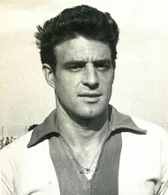

# Adelmo «Memo» Prenna

*Figurina Lampo di Memo Prenna capitano e cannoniere storico del Calcio Catania nel 1960-1961 — Licenza: Pubblico Dominio Italia (Art. 92 L. 633/1941 - >20 anni) — Crediti: Archivio Storico Calcio Catania*

**Adelmo Prenna**, universalmente noto come **"Memo" Prenna** (Corridonia, 27 maggio 1930 – Roma, 16 dicembre 2008), è stato un calciatore e allenatore di calcio italiano, di ruolo mezzala offensiva e attaccante. È stato il **principale realizzatore dell'epopea d'oro degli anni Sessanta** del [[societa/1946-club-calcio-catania|Club Calcio Catania]] guidato dal presidente [[societa/presidenti/ignazio-marcoccio|Ignazio Marcoccio]] e dall'allenatore [[tesserati/allenatori/carmelo-di-bella|Carmelo Di Bella]]: con **48 reti ufficiali complessive** (di cui **45/47 in campionato** e **29 in Serie A**) in **sei stagioni consecutive (1958–1964)**, occupa il **quinto posto nella classifica *all-time* dei marcatori rossazzurri** e il **terzo posto assoluto in Serie A** dietro ai soli [[tesserati/calciatori/gonzalo-bergessio|Gonzalo Bergessio]] (35) e [[tesserati/calciatori/giuseppe-mascara|Giuseppe Mascara]] (31).

## Dalla Promozione del 1959-1960 ai Trionfi in Serie A (1958–1964)

Cresciuto nella Maceratese e passato per SPAL, Livorno, Cagliari e Como, Adelmo Prenna approda a Catania nell'estate del **1958**, nel pieno della crisi post-[[vicende-legali/caso-scaramella-1955|Caso Scaramella]]. La svolta per la sua carriera e per la storia del club avviene nel dicembre 1958 con la promozione in prima squadra del tecnico [[tesserati/allenatori/carmelo-di-bella|Carmelo Di Bella]] e, nella primavera seguente, con l'insediamento del commissario straordinario (poi presidente) [[societa/presidenti/ignazio-marcoccio|Ignazio Marcoccio]].

Nella stagione 1959-1960, Di Bella costruisce attorno alla tecnica sopraffina, al tiro dalla distanza e al senso del gol di *"Memo"* Prenna la manovra offensiva rossazzurra: con **11 reti in 28 gare di Serie B**, Prenna trascina il Catania al 3º posto finale e alla **seconda promozione in Serie A della storia etnea**.

Nel successivo quadriennio in massima serie (1960–1964) allo [[stadio/angelo-massimino|Stadio Cibali]], Prenna — già trentenne all'esordio in Serie A — vive una straordinaria seconda giovinezza componendo reparti d'attacco leggendari con Salvador Calvanese, Mario Castellazzi, Alvaro Biagini, Bruno Petroni, Giancarlo Danova e i fuoriclasse stranieri **Horst Szymaniak** e **Cinesinho**:
- Nella [[stagioni/1960-1961|Stagione 1960-1961]] realizza **11 reti in 32 gare di Serie A** (tra cui una doppietta nel 4-3 al Milan e reti decisive a Roma, Torino e Napoli) e scende in campo da titolare il **4 giugno 1961** nel celebre [[partite/1960-1961/catania-inter-2-0|Catania-Inter 2-0 («Clamoroso al Cibali!»)]], chiudendo il torneo all'**8º posto**.
- Nel 1961-1962 si laurea nuovamente capocannoniere rossazzurro con **7 reti** (decisivo per la salvezza), per poi segnare **5 reti** nel 1962-1963 (inclusa una doppietta alla Roma e il gol nel 3-0 al Torino) e **6 reti** nella [[stagioni/1963-1964|Stagione 1963-1964]] (chiusa ancora all'**8º posto in Serie A** e con la finale della Coppa delle Alpi), lasciando Catania a 34 anni come il miglior marcatore di sempre del club nella massima divisione.

### Dettaglio Statistico per Stagione nel Club Calcio Catania

| Stagione | Società / Matricola | Categoria | Allenatore | Presenze Campionato | Reti Campionato | Coppe Naz./Int. (Reti) | Totale Presenze (Reti) |
| :--- | :--- | :--- | :--- | :---: | :---: | :---: | :---: |
| **1958-1959** | [[societa/1946-club-calcio-catania\|Club Calcio Catania]] (11700) | Serie B | F. Blason, [[tesserati/calciatori/nicolo-nicolosi\|N. Nicolosi]], [[tesserati/allenatori/carmelo-di-bella\|C. Di Bella]] | 25 | 5 | 2 (1) | **27 (6)** |
| **1959-1960** | [[societa/1946-club-calcio-catania\|Club Calcio Catania]] (11700) | Serie B | [[tesserati/allenatori/carmelo-di-bella\|Carmelo Di Bella]] | 28 | 11 | 1 (0) | **29 (11)** |
| **[[stagioni/1960-1961\|1960-1961]]** | [[societa/1946-club-calcio-catania\|Club Calcio Catania]] (11700) | Serie A | [[tesserati/allenatori/carmelo-di-bella\|Carmelo Di Bella]] | 32 | 11 | 2 (0) | **34 (11)** |
| **1961-1962** | [[societa/1946-club-calcio-catania\|Club Calcio Catania]] (11700) | Serie A | [[tesserati/allenatori/carmelo-di-bella\|Carmelo Di Bella]] | 25 | 7 | 2 (1) | **27 (8)** |
| **1962-1963** | [[societa/1946-club-calcio-catania\|Club Calcio Catania]] (11700) | Serie A | [[tesserati/allenatori/carmelo-di-bella\|Carmelo Di Bella]] | 18 | 5 | 2 (1) | **20 (6)** |
| **[[stagioni/1963-1964\|1963-1964]]** | [[societa/1946-club-calcio-catania\|Club Calcio Catania]] (11700) | Serie A | [[tesserati/allenatori/carmelo-di-bella\|Carmelo Di Bella]] | 18 | 6 | 3 (0) | **21 (6)** |
| **Totale Carriera** | **6 Stagioni (1958–1964)** | **Serie A / B** | — | **146 (93 A + 53 B)** | **45 (29 A + 16 B)** | **12 (3)** | **158 (48)** |

---

## Verifica Metodologica e Statistica

<strong>Sintesi Statistica e Impatto Storico</strong> (clicca per visualizzare i parametri e la quadratura)

- **Reti Ufficiali nel Catania:** **48** (5º marcatore assoluto della storia del club; **29 reti in Serie A**, primato resistito per 46 anni dal 1964 fino al sorpasso di Mascara nel 2010).
- **Presenze Ufficiali:** **158 gare complessive** (146 in campionato — 93 in Serie A e 53 in Serie B — più 12 tra Coppa Italia, Coppa delle Alpi e Coppa dell'Amicizia).
- **Partite Leggendarie:** Titolare con la maglia numero 10 nello storico [[partite/1960-1961/catania-inter-2-0|Catania-Inter 2-0 del 4 giugno 1961 («Clamoroso al Cibali!»)]] e protagonista di due **8º posti in Serie A** ([[stagioni/1960-1961|1960-1961]] e [[stagioni/1963-1964|1963-1964]]).

## Fonti e Bibliografia
* **Wikipedia Italia**, *[Voce Enciclopedica Ufficiale — Adelmo Prenna](https://it.wikipedia.org/wiki/Adelmo_Prenna)*.

1. **Antonio Buemi, Carlo Fontanelli, Roberto Quartarone, Alessandro Russo, Filippo Solarino**, *Tutto il Catania minuto per minuto (1929–2010)*, GEO Edizioni, Empoli, 2010, pp. 175–218.
2. **Archivio Storico Mimmo Rapisarda**, *I grandi protagonisti degli anni Sessanta: Adelmo "Memo" Prenna*, [mimmorapisarda.it](https://www.[mimmorapisarda.it](https://www.mimmorapisarda.it/)/).

- **Archivio Storico CalcioCatania.com**, *Scheda anagrafica e statistiche di Adelmo Prenna*, [calciocatania.com](https://www.[calciocatania.com](https://www.calciocatania.com/)/giocatori/giocatori.php?Prenna-648).
