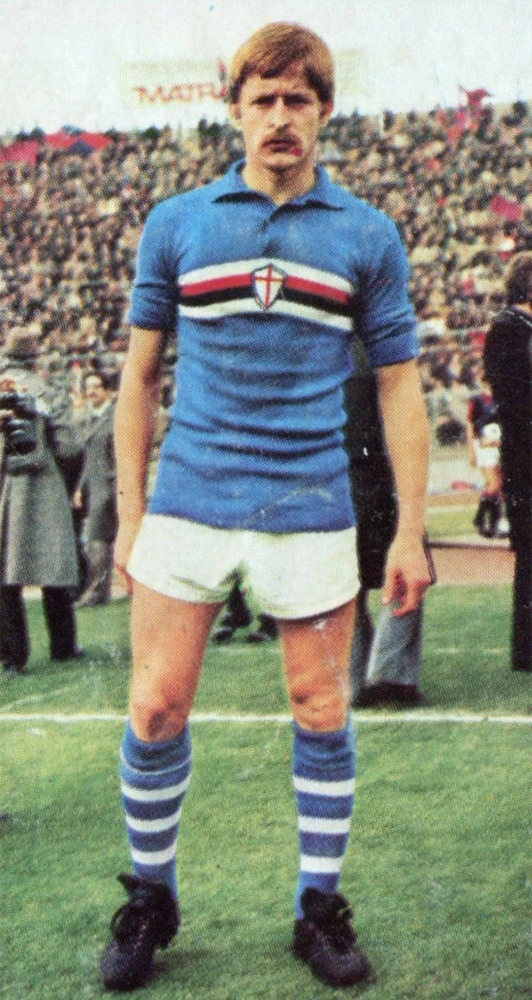

# Loris Boni (1979–1980)

*Figurina Panini ufficiale del centrocampista Loris Boni con la casacca del Calcio Catania 1979-1980 — Licenza: Pubblico Dominio Italia (Art. 92 L. 633/1941 - >20 anni) — Crediti: Archivio Storico Calcio Catania*

**Loris Boni** (Remedello, 14 gennaio 1953)  stato un brillante centrocampista del Calcio Catania durante la stagione trionfale di Serie C1 1979-1980 conclusasi con la promozione in Serie B sotto la guida del presidente [[societa/presidenti/angelo-massimino|Angelo Massimino]] e dell'allenatore Lino De Petrillo. Con 32 presenze e un gol pesantissimo, Boni fu il regista carismatico del centrocampo etneo.

## Collegamenti Correlati
* [[stagioni/1979-1980|Stagione 1979-1980 — Promozione in Serie B]]
* [[societa/presidenti/angelo-massimino|Angelo Massimino]]

## Fonti e Bibliografia
* Antonio Buemi, Carlo Fontanelli, Roberto Quartarone, Alessandro Russo, Filippo Solarino, *Tutto il Catania minuto per minuto*, GEO Edizioni, Empoli, 2010.
* *Almanacco Illustrato del Calcio*, Panini Edizioni, Modena.
* [CalcioCatania.com](https://www.[calciocatania.com](https://www.calciocatania.com/)/) — Archivio storico e statistiche ufficiali.
