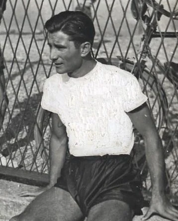

# Mario Miltone (1934–1937)

*Fotografia storica del difensore Mario Miltone con la casacca dell'Associazione Fascista Calcio Catania — Licenza: Pubblico Dominio Italia (Art. 92 L. 633/1941 - >20 anni) — Crediti: Archivio Storico Calcio Catania*

**Mario Miltone** (Torino, 24 marzo 1906) è stato un difensore italiano che ha vestito la maglia rossazzurra dell'[[societa/1929-ss-catania|S.S. Catania]] tra il 1934 e il 1937. Punto fermo del reparto arretrato etneo, vanta 84 presenze ufficiali in campionato, contribuendo alle solide stagioni del Catania nei primi campionati nazionali a girone unico di Serie B.

## Collegamenti Correlati
* [[stagioni/1934-1935|Stagione 1934-1935]]
* [[tesserati/calciatori/nicolo-nicolosi|Nicol Nicolosi]]

## Fonti e Bibliografia
* **Wikipedia Italia**, *[Voce Enciclopedica Ufficiale — Mario Miltone](https://it.wikipedia.org/wiki/Mario_Miltone)*.
* Antonio Buemi, Carlo Fontanelli, Roberto Quartarone, Alessandro Russo, Filippo Solarino, *Tutto il Catania minuto per minuto*, GEO Edizioni, Empoli, 2010.
* *Almanacco Illustrato del Calcio*, Panini Edizioni, Modena.
* [CalcioCatania.com](https://www.[calciocatania.com](https://www.[calciocatania.com](https://www.calciocatania.com/)/)/) — Archivio storico e statistiche ufficiali.