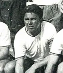

# Sidney Cunha Cinesinho — Scheda Giocatore nel Calcio Catania

*Figurina Panini del fuoriclasse brasiliano Cinesinho in maglia rossazzurra del Catania — Licenza: Pubblico Dominio Italia (Art. 92 L. 633/1941 - >20 anni) — Crediti: Archivio Storico Calcio Catania*

*Ritratto del calciatore Sidney Cunha Cinesinho in maglia rossazzurra del Calcio Catania — Licenza: Creative Commons CC BY-SA 4.0 — Crediti: Archivio Storico Calcio Catania*

**Sidney Cunha Cinesinho** è stato un calciatore del [[societa/matricola-11700|Calcio Catania]], nel ruolo di **Centrocampista**.

---

## 1. Dati di Rendimento in Maglia Rossazzurra

* **Ruolo**: Centrocampista
* **Presenze Ufficiali complessive**: 59
* **Stagioni disputate**: 2
* **Stadio di casa**: [[stadio/angelo-massimino|Stadio Angelo Massimino]]

---

## 2. Note e Scheda di Carriera

Il calciatore ha difeso i colori rossazzurri durante la sua militanza all'ombra dell'Etna, contribuendo alle vicende sportive del sodalizio etneo nei campionati nazionali.

---

## 3. Collegamenti e Voci Correlate

* [[societa/matricola-11700|Calcio Catania: La storia societaria e la Matricola 11700]]
* [[stadio/angelo-massimino|Stadio Angelo Massimino (ex Cibali)]]
* [[maglie/simbologia-colori-scudetti|I colori e la simbologia rossazzurra]]
* [[media/testate/calciocatania-com|Archivio Storico e Portale d'Informazione CalcioCatania]]

---

## Fonti e Bibliografia

1. **Salvatore Giovanni Emanuele, Max Licari**, *Scheda anagrafica e statistiche di Sidney Cunha Cinesinho*, in [https://www.[calciocatania.com](https://www.calciocatania.com/)/giocatori/giocatori.php?Cinesinho-639](https://www.[calciocatania.com](https://www.calciocatania.com/)/giocatori/giocatori.php?Cinesinho-639), 2024.
2. **Antonio Buemi, Carlo Fontanelli, Roberto Quartarone, Alessandro Russo, Filippo Solarino**, *Tutto il Catania minuto per minuto*, GEO Edizioni, Empoli, 2010.
