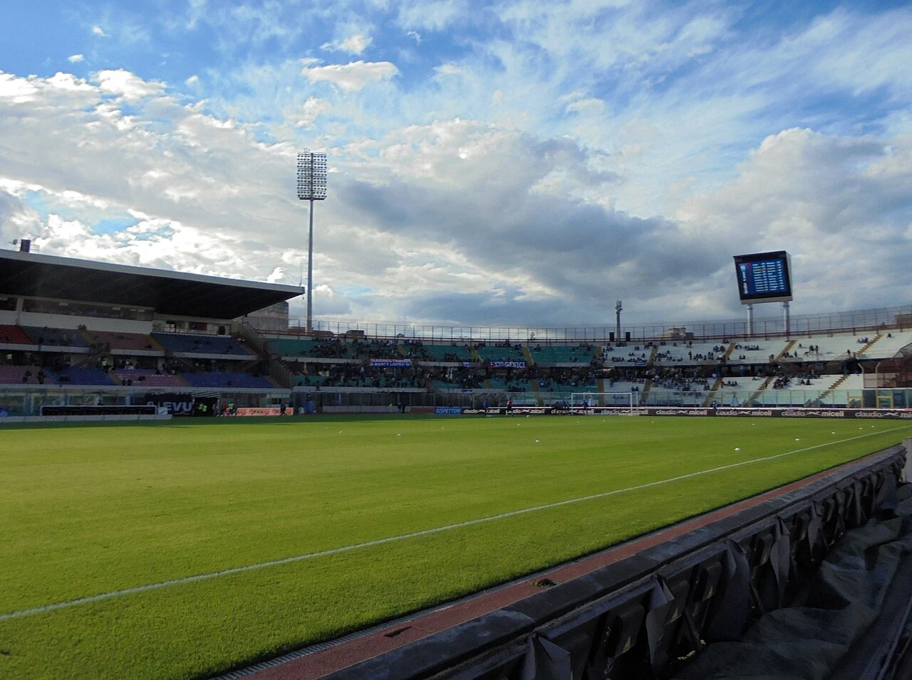

# Stadio Angelo Massimino (Stadio Cibali)

*Panoramica aerea dello Stadio Angelo Massimino Cibali durante una partita del Calcio Catania — Licenza: Creative Commons CC BY-SA 4.0 — Crediti: Archivio Storico Calcio Catania*

Lo **Stadio Angelo Massimino**, storicamente e popolarmente noto come **Stadio Cibali** dal nome dell'omonimo quartiere cittadino in cui sorge, è il principale impianto calcistico della città di Catania e sede delle gare interne del club rossazzurro sin dal **28 novembre 1937**.

> [!info] Denominazioni Ufficiali nel Tempo (temporal_display_rules)
> - **1937–1943:** *Stadio Polisportivo Cibali* (intitolato nel periodo bellico a *Italo Balbo*)
> - **1945–2002:** *Stadio Comunale Cibali*
> - **Dal 16 giugno 2002:** *Stadio Angelo Massimino* (in memoria del *Presidentissimo* [[societa/presidenti/angelo-massimino|Angelo Massimino]])

---

## Storia Architettonica e Ristrutturazioni

| Anno | Evento Storico / Intervento Strutturale | Dettagli Tecnici e Agonistici |
| :--- | :--- | :--- |
| **28 novembre 1937** | Inaugurazione ufficiale su progetto dell'arch. **Raffaele Leone**. | Sostituisce il vecchio campo di Piazza Esposizione; gara inaugurale **Catania-Foggia 1-0** (Serie C 1937-38). |
| **4 giugno 1961** | Teatro del celebre [[partite/1960-1961/catania-inter-2-0\|Catania-Inter 2-0]]. | Sandro Ciotti conia in radiocronaca la locuzione nazionale *«Clamoroso al Cibali!»*. |
| **1996–1997** | Ristrutturazione per la **XIX Universiade Estiva (Sicilia '97)**. | Demolizione e ricostruzione della [[tifoseria/curva-sud/falange-d-assalto\|Curva Sud]] su due anelli separati, copertura della Tribuna A e rifacimento della pista d'atletica. |
| **16 giugno 2002** | Intitolazione alla memoria di [[societa/presidenti/angelo-massimino\|Angelo Massimino]]. | All'indomani della promozione in Serie B conquistata a Taranto il 9 giugno 2002. |
| **2022–2024** | Riqualificazione moderna (fondi comunitari). | Installazione dei nuovi seggiolini rossazzurri con scritta *CATANIA 1946*, nuovo manto erboso, tabellone LED e restyling delle tribune. |

---

## Fonti e Bibliografia

1. **Antonio Buemi, Carlo Fontanelli, Roberto Quartarone, Alessandro Russo, Filippo Solarino**, *Tutto il Catania minuto per minuto (1929–2010)*, GEO Edizioni, Empoli, 2010.
2. **Comune di Catania**, *Atti di intitolazione dello Stadio Comunale ad Angelo Massimino*, 16 giugno 2002.
