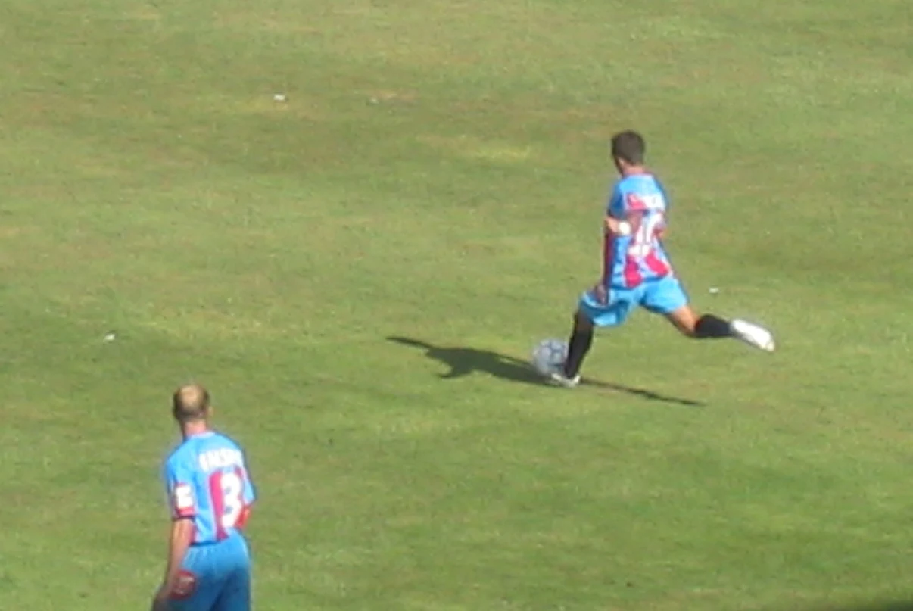

# Storia degli Sponsor Commerciali e Tecnici del Calcio Catania (1982-2026)

L'introduzione della pubblicità sulle maglie da gioco nel calcio professionistico italiano, autorizzata dalla FIGC a partire dalla stagione sportiva 1981-1982, inaugurò una profonda trasformazione economica e d'immagine per il club etneo. Dalla prima leggendaria intesa con la multinazionale dolciaria **Haribo** fino ai contratti pluriennali dell'epopea in Serie A con **SP Energia Siciliana**, le maglie rossazzurre hanno raccontato quattro decenni di evoluzione industriale e sportiva.

---

## 1. Il Pioniere Haribo e la Promozione di Roma (1982-1983)

Il primo sponsor commerciale ufficiale a comparire sul petto dei calciatori etnei fu il celebre marchio tedesco di caramelle **Haribo**, nella stagione di Serie B [[stagioni/1982-1983\|1982-1983]]. 

La sponsorizzazione, fortemente voluta dal presidente [[societa/presidenti/angelo-massimino\|Angelo Massimino]] per finanziare la campagna acquisti del tecnico Gianni Di Marzio, divenne immediatamente un'icona di culto:
* Il logo con il simpatico orsetto giallo e la scritta a caratteri cubitali rossi spiccava in modo indelebile sia sulla maglia casalinga a bande larghe rossazzurre, sia sulla seconda maglia bianca da trasferta.
* Con questa maglia il Catania disputò gli storici spareggi promozione allo Stadio Olimpico di Roma del giugno 1983 contro Como e Cremonese, sospinto dalla straordinaria *"carica dei quarantamila"* sostenitori siciliani.
* Lo sponsor tecnico dell'annata fu l'azienda italiana **Degi**, prima di passare l'anno seguente alla prestigiosa **Ennerre (NR)** di Nicola Raccuglia nel massimo campionato di Serie A.

---

## 2. La Serie A e il Boom dei Marchi Industriali (1983-1996)

Negli anni Ottanta e Novanta, il Catania alternò partner locali e aziende di respiro nazionale:
* **S7** (1983-1984): marchio tessile sportivo che accompagnò il Catania nella complicata stagione di Serie A.
* **Hitachi** (1985-1986): colosso giapponese dell'elettronica, partner d'eccezione per la Serie B.
* **Pasta Poiatti** (1986-1988): celebre pastificio siciliano di Mazara del Vallo, legato all'identità agroalimentare dell'isola.
* **Giò.Vi** (1993-1996): ditta tessile catanese che rimase al fianco di Massimino nei campionati di Eccellenza, Campionato Nazionale Dilettanti (CND) e Serie C2 dopo la traumatica radiazione federale del 1993.

---

## 3. L'Età dell'Oro in Serie A: Da SP Energia Siciliana a Wind Jet (2006-2014)

Con l'avvento della presidenza di [[societa/presidenti/antonino-pulvirenti\|Antonino Pulvirenti]] e la direzione generale di [[societa/presidenti/pietro-lo-monaco\|Pietro Lo Monaco]], il Catania conobbe la sua striscia consecutiva record di otto campionati in Serie A (2006–2014).

In questo periodo si consolidò una delle sponsorizzazioni più longeve e fortunate del calcio meridionale:
* **SP Energia Siciliana** (2006–2012): operatore leader della distribuzione petrolifera e dei carburanti, guidato dalla famiglia Puglisi. Il marchio SP campeggiò sulle maglie in tutti i capolavori sportivi del club: dal 4-0 nel [[partite/2008-2009/palermo-catania-0-4\|derby di Palermo del 2009]] al celebre 3-1 contro l'[[partite/2009-2010/catania-inter-3-1\|Inter di Mourinho del marzo 2010]].
* **Wind Jet** (2007–2009): la prima compagnia aerea low cost siciliana, fondata dallo stesso Pulvirenti, figurò come co-sponsor e partner di mobilità della squadra.
* **TTT Lines** (2012–2014): compagnia di navigazione marittima che subentrò come main sponsor negli anni dell'ottavo posto record con Rolando Maran (56 punti conquistati).

---

## 4. Matrice Sinottica dei Partner Tecnici e Commerciali

| Stagioni | Fornitore Tecnico (Kit) | Main Sponsor Commerciale | Categoria FIGC |
| :--- | :--- | :--- | :--- |
| **1982–1983** | Degi | Haribo | Serie B (Promozione) |
| **1983–1984** | Ennerre (NR) | S7 | Serie A |
| **1985–1986** | Adidas | Hitachi | Serie B |
| **1986–1988** | Latas | Pasta Poiatti | Serie B / Serie C1 |
| **1992–1993** | ABM | Jolly Componibili | Serie C1 |
| **1993–1996** | Gems / Devis | Giò.Vi | C.N.D. / Serie C2 |
| **1999–2001** | Umbro | SP Energia Siciliana | Serie C1 |
| **2005–2006** | Legea | SP Energia Siciliana | Serie B (Promozione) |
| **2006–2010** | Legea | SP Energia Siciliana / Wind Jet | Serie A |
| **2010–2014** | Givova | SP Energia Siciliana / TTT Lines | Serie A (Record punti) |
| **2017–2021** | Givova | Domus Bet / SuperConveniente | Serie C |
| **2022–2023** | Erreà | SuperConveniente | Serie D (Vittoria girone) |
| **2023–2026** | Erreà | SuperConveniente / Funivia dell'Etna | Serie C |

---

## 5. Collegamenti e Voci Correlate

* [[maglie/simbologia-colori-scudetti\|Araldica, Colori Sociali e Stemmi Ufficiali (1929-2026)]]
* [[stagioni/1982-1983\|La Stagione degli Spareggi di Roma e l'era Haribo]]
* [[societa/presidenti/angelo-massimino\|Angelo Massimino e i contratti storici con le ditte etnee]]
* [[societa/presidenti/antonino-pulvirenti\|Antonino Pulvirenti e il sodalizio con SP Energia Siciliana]]
* [[societa/presidenti/ross-pelligra\|Ross Pelligra e la partnership tecnica con Erreà]]

---

## Fonti e Bibliografia

1. **Antonio Buemi, Carlo Fontanelli, Roberto Quartarone, Alessandro Russo, Filippo Solarino**, *Tutto il Catania minuto per minuto (1929-2010)*, GEO Edizioni, Empoli, 2010. ISBN 978-88-6999-036-6.
2. **Roberto Quartarone**, *Gli sponsor tecnici e commerciali del Catania dal 1979 ad oggi*, in [tuttoilcataniaminutoperminuto.it](https://www.tuttoilcataniaminutoperminuto.it/), 2024.
3. **Luigi Prestinenza**, *Catania e il pallone: mezzo secolo di passione all'ombra dell'Etna*, Editoriale La Sicilia, Catania, 1984.
4. **Almanacco Illustrato del Calcio**, Edizioni Panini, Modena, volumi dal 1983 al 2026.