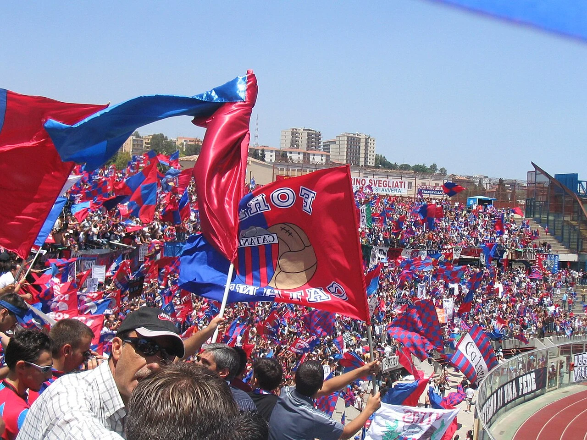

# Falange d'Assalto Rossazzurra

*Storico striscione del gruppo ultras Falange d'Assalto esposto allo Stadio Cibali nel 1979 — Licenza: Pubblico Dominio Italia (Art. 92 L. 633/1941 - >20 anni) — Crediti: Archivio Storico Calcio Catania*

La **Falange d'Assalto Rossazzurra** è il gruppo storico fondativo del movimento ultras organizzato a Catania, sorto nel **1979** nel popolare rione del **Castello Ursino** su iniziativa di **Francesco Famoso**, universalmente noto nel panorama delle curve italiane ed europee come *"Ciccio Falange"*.

> [!info] Identità e Collocazione Topografica
> Posizionata ininterrottamente dal 1979 al centro della balaustra dell'**Anello Inferiore della [[tifoseria/index|Curva Sud]]** dello [[stadio/angelo-massimino|Stadio Cibali / Angelo Massimino]], la Falange rappresenta la matrice storica da cui si è sviluppata l'intera aggregazione giovanile del settore popolare meridionale.

---

## Storia ed Evoluzione in Curva Sud

Fondata alla vigilia della stagione 1979-1980 (culminata con la promozione dalla Serie C1 alla Serie B sotto la presidenza di [[societa/presidenti/angelo-massimino|Angelo Massimino]]), la Falange ha guidato tutti i momenti cardine dell'identità ultras etnea: dall'epico esodo dei 40.000 allo Stadio Olimpico di Roma nel giugno 1983 fino alla difesa intransigente della matricola storica **11700** nell'estate del 1993.

Negli anni Novanta dalla Falange si è staccata l'ala radicale dei *Decisi*, mentre nel **1991** si è affiancato nel medesimo anello inferiore il gruppo **Irriducibili 1991**, nato inizialmente con il nome *Primo Amore* per iniziativa di un nucleo di ragazzi provenienti dalla Curva Nord.

| Anno / Periodo | Evento Storico per il Gruppo e la Curva Sud | Impatto Identitario e Relazionale |
| :--- | :--- | :--- |
| **1979** | Fondazione nel quartiere del Castello Ursino per mano di Francesco "Ciccio" Famoso. | Nascita ufficiale del movimento ultras organizzato a Catania in [[tifoseria/index|Curva Sud]]. |
| **Giugno 1983** | Coordinamento coreografico dell'esodo di 40.000 catanesi a Roma per gli spareggi contro Como e Cremonese. | Consacrazione nazionale della tifoseria rossazzurra e ritorno in Serie A nella Stagione 1982-1983. |
| **1993–1994** | Boicottaggio totale dell'Atletico Catania di Franco Proto dopo il declassamento in Eccellenza. | Salvaguardia dell'identità popolare e media di 9.000 spettatori al [[stadio/angelo-massimino|Cibali]] nel campionato di Eccellenza 1993-1994. |
| **2015–2016** | Scelta strategica della Curva Sud di aderire alla Tessera del Tifoso dopo la retrocessione d'ufficio in Lega Pro. | Presenza ininterrotta in ogni trasferta dietro lo striscione unificante **_Estrema Appartenenza_**. |
| **1 febbraio 2017** | Scomparsa dello storico leader Francesco "Ciccio" Famoso all'età di 60 anni. | Camera ardente ed esequie partecipate da migliaia di cittadini; tributi ufficiali esposti dalle curve di Borussia Dortmund, Bayern Monaco, Napoli, Benevento e Crotone. |

---

## Fonti e Bibliografia

1. **Antonio Buemi, Carlo Fontanelli, Roberto Quartarone, Alessandro Russo, Filippo Solarino**, *Tutto il Catania minuto per minuto (1929–2010)*, GEO Edizioni, Empoli, 2010.
2. **La Sicilia**, *Catania saluta Ciccio Famoso, il fondatore della Falange d'Assalto*, Cronaca di Catania, 2 febbraio 2017.
3. **Archivio Fotografico Mimmo Rapisarda**, *Sezione Tifoseria e Curva Sud*, [mimmorapisarda.it](https://www.mimmorapisarda.it/).