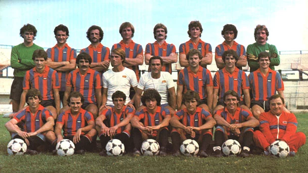

# L'Esodo dei 40.000 allo Stadio Olimpico di Roma (1983)

*La marea di 40.000 tifosi rossazzurri allo Stadio Olimpico di Roma per gli spareggi di Serie B del giugno 1983 — Licenza: Pubblico Dominio Italia (Art. 92 L. 633/1941 - >20 anni) — Crediti: Archivio Storico Calcio Catania*

Nel giugno del 1983 si concentrarono nella Capitale due snodi di eccezionale pressione logistica, sportiva e di ordine pubblico legati all'epilogo del campionato di Serie B [[stagioni/1982-1983|1982-1983]]: la trasferta di campionato contro la Lazio (5 giugno 1983) e il successivo triangolare di spareggio promozione contro Como e Cremonese (18-25 giugno 1983).

L'**Esodo dei 40.000 allo Stadio Olimpico di Roma** rappresenta la più imponente migrazione di una tifoseria in trasferta nella storia del calcio italiano del dopoguerra. In occasione dello spareggio finale contro la Cremonese, decine di migliaia di sostenitori rossazzurri partiti dalla Sicilia e dalle comunità dell'emigrazione etnea nel Centro-Nord tinsero integralmente di rosso e azzurro l'Olimpico, trascinando il [[societa/1967-calcio-catania-spa-massimino|Calcio Catania S.p.A.]] del presidente [[societa/presidenti/angelo-massimino|Angelo Massimino]] e dell'allenatore [[tesserati/allenatori/gianni-di-marzio|Gianni Di Marzio]] in Serie A dopo tredici anni di assenza.

> [!abstract] Scheda Sinottica Giudiziaria e di Ordine Pubblico
> - **Codice Scheda:** `SCHEDA-1983-ROMA`
> - **Date Eventi:** 05/06/1983 (Lazio-Catania) – 18/06/1983 e 25/06/1983 (Spareggi Como e Cremonese).
> - **Luogo:** Roma, Stadio Olimpico, Stazione Roma Termini e direttrice autostradale/ferroviaria tirrenica.
> - **Tipologia Evento:** Esodo di massa interregionale, tensioni tra tifoserie rivali, cariche di polizia e gestione straordinaria di trasporti speciali.
> - **Conseguenze di Pubblica Sicurezza:** Cariche di alleggerimento, uso di idranti di sicurezza all'Olimpico, fermi e denunce per porto di oggetti contundenti e danneggiamento di materiale rotabile ferroviario.
> - **Fonti Principali:** *Stampa Sera* (06/06/1983), *La Stampa*, *La Gazzetta dello Sport* (19/06/1983 e 26/06/1983), *Corriere dello Sport*, *La Sicilia*.

---

## 1. La Prima Tensione: Lazio-Catania del 5 Giugno 1983

Il primo momento critico di ordine pubblico si verificò domenica **5 giugno 1983**, in occasione dell'ultima giornata della stagione regolare. Al Catania serviva un punto per blindare la promozione diretta o lo spareggio, mentre la Lazio di Juan Carlos Morrone cercava la certezza matematica della Serie A.

Oltre **15.000 sostenitori etnei** raggiunsero Roma a bordo di treni ordinari e convogli speciali, affollando la Curva Sud e le tribune in una giornata caratterizzata da caldo afoso estremo. La forte rivalità tra le due fazioni sfociò in ripetuti tafferugli sia all'esterno dei tornelli del Foro Italico sia a ridosso dei settori di separazione interni.

La forza pubblica fu costretta a effettuare **ripetute cariche di alleggerimento** e ad azionare gli **idranti di sicurezza** della Polizia sia per disperdere i fronti di scontro sia per fronteggiare i frequenti malori e collassi causati dall'ammassamento delle gradinate sotto il sole battente. L'incontro terminò 2-1 per i biancocelesti, costringendo il Catania a disputare gli spareggi a tre per via della parità a quota 45 punti con Como e Cremonese.

---

## 2. Il Triangolare di Spareggio: Il Popolo Rossazzurro Conquista Roma

Per assegnare il terzo posto promozione per la [[stagioni/1983-1984|Serie A 1983-1984]], la Lega Nazionale Professionisti scelse il campo neutro dello Stadio Olimpico di Roma per un mini-girone a tre:
1. **Sabato 18 giugno 1983:** [[partite/1982-1983/spareggio-catania-como-1-0|Catania-Como 1-0]]
2. **Mercoledì 22 giugno 1983:** Cremonese-Como 0-0
3. **Sabato 25 giugno 1983:** [[partite/1982-1983/spareggio-catania-cremonese-0-0|Catania-Cremonese 0-0]]

### Catania-Como 1-0 (18 Giugno 1983)
Nel primo confronto contro il Como di Tarcisio Burgnich, oltre **25.000 sostenitori catanesi** presero posto tra Curva Sud, Tribuna Tevere e Monte Mario. La rete decisiva fu siglata al 71' da **Angelo Crialesi** con un colpo di testa in tuffo su cross di Mastalli.

### Catania-Cremonese 0-0 (25 Giugno 1983) e la "Carica dei Quarantamila"
Dopo il pareggio tra lombardi, al Catania bastava non perdere contro la Cremonese di Emiliano Mondonico e del giovane Gianluca Vialli. Sin dalla notte tra venerdì 24 e sabato 25 giugno, il centro storico di Roma (Piazza di Spagna, Fontana di Trevi, Villa Borghese, Stazione Termini) venne invaso da una fiumana pacifica stimata dalle testate nazionali in **oltre 40.000 tifosi del Catania**.

| Data e Incontro | Risultato | Marcatori | Presenza Stimata Tifosi Catanesi | Esito Finale |
| :--- | :---: | :--- | :---: | :--- |
| **18 giugno 1983** [[partite/1982-1983/spareggio-catania-como-1-0|Catania-Como]] | **1-0** | 71' Angelo Crialesi (C) | ~25.000 spettatori etnei | Catania primo a quota 2 pt. |
| **22 giugno 1983** Cremonese-Como | **0-0** | — | — | Como eliminato (1 pt); Cremonese a 1 pt. |
| **25 giugno 1983** [[partite/1982-1983/spareggio-catania-cremonese-0-0|Catania-Cremonese]] | **0-0** | — | **~40.000 spettatori etnei** | **Catania promosso in Serie A** (3 pt). |

> [!quote] La Testimonianza Storica di Emiliano Mondonico
> *"Quando siamo entrati in campo all'Olimpico e abbiamo alzato gli occhi verso gli spalti tutti colorati di rosso e d'azzurro, con quarantamila persone che cantavano per il Catania, abbiamo capito che non stavamo giocando contro una squadra di calcio, ma contro un popolo intero."* — **Emiliano Mondonico**, allenatore della Cremonese.

---

## 3. Dispositivo di Pubblica Sicurezza e Gestione Criminologica

Sul versante dell'ordine pubblico, la mobilitazione del giugno 1983 ricadde in piena **Fase 1 (Contenimento Reattivo)** dell'evoluzione del tifo sportivo in Italia:
- **Dispositivo Interforze lungo la Direttrice Tirrenica:** Polizia di Stato, Arma dei Carabinieri e Polfer predisposero un massiccio filtraggio presso la Stazione Centrale di Catania, il porto di Messina, Villa San Giovanni, il nodo autostradale di Salerno e lo scalo di Roma Termini.
- **Materiale Rotabile e Contravvenzioni:** Vennero formalizzate denunce e verbali per danneggiamento aggravato di arredi dei convogli ferroviari ordinari e speciali delle Ferrovie dello Stato.
- **Sequestri e Fermi Preventivi:** Ai varchi dell'Olimpico furono sequestrati centinaia di bastoni di bandiere e aste rigide in legno vietate dai regolamenti di pubblica sicurezza, ma la massiccia dispersione della folla festante nel centro monumentale di Roma scongiurò la degenerazione in guerriglia urbana coordinata.

---

## Fonti e Rassegna Documentale

1. **Antonio Buemi, Carlo Fontanelli, Roberto Quartarone, Alessandro Russo, Filippo Solarino**, *Tutto il Catania minuto per minuto (1929–2010)*, GEO Edizioni, Empoli, 2010, pp. 295–302.
2. **Stampa Sera**, *Tensioni e cariche all'Olimpico per l'invasione siciliana*, Cronaca di Roma, Edizione del 6 giugno 1983.
3. **La Gazzetta dello Sport**, *La marea del Sud travolge l'Olimpico: Catania in paradiso*, 19 e 26 giugno 1983.
4. **Il Corriere dello Sport**, *Quarantamila cuori rossazzurri: il Catania torna nell'Olimpo del calcio*, 26 giugno 1983.
5. **La Sicilia**, *La favola dell'Olimpico: quarantamila fratelli per il trionfo di Massimino e Di Marzio*, 26 giugno 1983.
