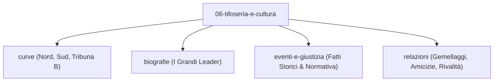

# Tifoseria e Cultura Rossazzurra

L'identità calcistica di Catania affonda le radici in un tessuto urbano in cui l'appartenenza ai colori rossazzurri trascende la mera dimensione sportiva per farsi marcatore antropologico, sociale e civile. Dalla fondazione della Società Sportiva Catania nel 1929 e dalla rinascita della matricola 11700 nel 1946 fino ai giorni nostri, lo [[stadio/angelo-massimino|Stadio Angelo Massimino (Cibali)]] è stato il teatro in cui generazioni di tifosi hanno espresso un attaccamento viscerale e indomito.

Questa sezione raccoglie la documentazione organica, archivistica e sociologica del tifo catanese: l'evoluzione delle curve, i gruppi storici, i leader carismatici, i grandi eventi giudiziari, la geopolitica delle alleanze e la mitologia degli spalti.

---

## Struttura dell'Area Tematica

---

## 1. I Settori del Massimino e i Gruppi Organizzati

Lo stadio Massimino si articola su tre poli indipendenti:
* **[[06-tifoseria-e-cultura/curve/curva-nord/index|Curva Nord]]**: Sede fondativa della [[06-tifoseria-e-cultura/curve/curva-sud/falange-d-assalto|Falange d'Assalto]] (1979-2015), guidata dal 1993 da [[06-tifoseria-e-cultura/curve/curva-nord/a-sostegno-di-una-fede|A Sostegno di una Fede]] e animata da storici gruppi come [[06-tifoseria-e-cultura/curve/curva-nord/i-pazzi|I Pazzi]], [[06-tifoseria-e-cultura/curve/curva-nord/nord-kaos|Nord Kaos]], [[06-tifoseria-e-cultura/curve/curva-nord/skizzati-passarello|Skizzati Passarello]] e la rete dei [[06-tifoseria-e-cultura/curve/curva-nord/mecha-katane|clan rionali]].
* **[[06-tifoseria-e-cultura/curve/curva-sud/index|Curva Sud]]**: Il settore popolare meridionale, avviato dai [[06-tifoseria-e-cultura/curve/curva-sud/catania-raiders|Catania Raiders]] nel 1982 e guidato dagli [[06-tifoseria-e-cultura/curve/curva-sud/irriducibili-1991|Irriducibili (1991)]]. Nel 2015 ha accolto la Falange d'Assalto dando vita allo striscione unitario [[06-tifoseria-e-cultura/curve/curva-sud/estrema-appartenenza|Estrema Appartenenza]].
* **[[06-tifoseria-e-cultura/curve/tribuna-b/index|Tribuna B (Gradinata)]]**: Il terzo polo autonomo, custode delle iniziative del [[06-tifoseria-e-cultura/curve/tribuna-b/gruppo-tattaresu|Gruppo Tattaresu]], culla dell'[[06-tifoseria-e-cultura/curve/tribuna-b/anr|A.N.R.]] nel 2000 e dal 2015 sede dell'[[06-tifoseria-e-cultura/curve/tribuna-b/mecha-klan|Ultras Mecha Klan Catania (MCK)]].

---

## 2. Biografie dei Leader e Protagonisti

* **[[06-tifoseria-e-cultura/biografie/ciccio-famoso|Francesco "Ciccio" Famoso]]**: *«Ciccio Falange»*, fondatore nel 1979 e capo carismatico indiscusso per quasi quarant'anni.
* **[[06-tifoseria-e-cultura/biografie/michele-spampinato|Michele Spampinato]]**: Guida di *A Sostegno di una Fede* dal 1993 al 2007 e autore di *«Quando saremo tutti nella Nord»*.
* **[[06-tifoseria-e-cultura/biografie/pippo-tarraresu|Giuseppe "Pippo" Tarraresu]]**: Anima della Tribuna B, compagno di catene alla FIGC nel 1993 e custode del telo gigante di Angelo Massimino.
* **[[06-tifoseria-e-cultura/biografie/antonino-speziale|Antonino Speziale]]** e **[[06-tifoseria-e-cultura/biografie/daniele-natale-micale|Daniele Natale Micale]]**: Le figure al centro del processo per i fatti del 2 febbraio 2007.

---

## 3. Eventi Storici, Ordine Pubblico e Giustizia

* **[[06-tifoseria-e-cultura/eventi-e-giustizia/tragedia-custode-cibali-1983|La Tragedia del Custode del Cibali (12 Giugno 1983)]]**: La sparatoria di Angelo Grasso durante Catania-Perugia, 1 morto e 32 feriti.
* **[[06-tifoseria-e-cultura/eventi-e-giustizia/radiazione-1993-rivolta-urbana|La Radiazione del 1993 e la Rivolta di Popolo]]**: La battaglia civile per la matricola 11700.
* **[[06-tifoseria-e-cultura/eventi-e-giustizia/derby-celeste-messina-2001-curro|Il Dramma del Celeste (17 Giugno 2001)]]**: La morte del giovane messinese Antonino Currò.
* **[[06-tifoseria-e-cultura/eventi-e-giustizia/scontri-2-febbraio-2007-raciti|Il 2 Febbraio 2007 e la Morte dell'Ispettore Raciti]]**: La notte di guerriglia che ha cambiato la legislazione sugli stadi in Italia (Legge 41/2007).
* **[[06-tifoseria-e-cultura/eventi-e-giustizia/finale-coppa-euganeo-padova-2024|Padova-Catania (19 Marzo 2024)]]**: Gli scontri all'Euganeo, 28 DASPO e la recidiva dei fatti del 2007.
* **[[06-tifoseria-e-cultura/eventi-e-giustizia/guerriglia-piazza-montessori-2026|Piazza Montessori (19 Settembre 2026)]]**: Lo scontro fratricida tra Curva Nord e Curva Sud.
* **[[06-tifoseria-e-cultura/eventi-e-giustizia/mitologia-e-trofei-ultras|Mitologia, Cimeli e Folklore]]**: La sottrazione dello striscione *Fighters Juve*, il drappo *South Lander*, il frigorifero volante al Celeste e il murale *Cinquanta volti per il Cibali*.

---

## 4. Diplomazia degli Spalti: Gemellaggi, Amicizie e Rivalità

* **[[06-tifoseria-e-cultura/relazioni/gemellaggi/index|Gemellaggi Ufficiali]]**: [[06-tifoseria-e-cultura/relazioni/gemellaggi/genoa|Genoa]], [[06-tifoseria-e-cultura/relazioni/gemellaggi/crotone|Crotone]], [[06-tifoseria-e-cultura/relazioni/gemellaggi/triestina|Triestina]], [[06-tifoseria-e-cultura/relazioni/gemellaggi/benevento|Benevento]], [[06-tifoseria-e-cultura/relazioni/gemellaggi/trapani|Trapani]].
* **[[06-tifoseria-e-cultura/relazioni/amicizie/index|Patti di Amicizia]]**: [[06-tifoseria-e-cultura/relazioni/amicizie/napoli|Napoli]], [[06-tifoseria-e-cultura/relazioni/amicizie/borussia-dortmund|Borussia Dortmund]], [[06-tifoseria-e-cultura/relazioni/amicizie/inter|Inter]], [[06-tifoseria-e-cultura/relazioni/amicizie/parma|Parma]], [[06-tifoseria-e-cultura/relazioni/amicizie/bayern-monaco|Bayern Monaco]].
* **[[06-tifoseria-e-cultura/relazioni/rivalita/index|Rivalità Storiche]]**: [[06-tifoseria-e-cultura/relazioni/rivalita/palermo|Palermo]], [[06-tifoseria-e-cultura/relazioni/rivalita/messina|Messina]], [[06-tifoseria-e-cultura/relazioni/rivalita/siracusa|Siracusa]], [[06-tifoseria-e-cultura/relazioni/rivalita/salernitana|Salernitana]], [[06-tifoseria-e-cultura/relazioni/rivalita/taranto|Taranto]], [[06-tifoseria-e-cultura/relazioni/rivalita/roma|Roma]], [[06-tifoseria-e-cultura/relazioni/rivalita/catanzaro|Catanzaro]], [[06-tifoseria-e-cultura/relazioni/rivalita/perugia|Perugia]].

---

## Fonti Certificate

1. **Antonio Buemi, Carlo Fontanelli, Roberto Quartarone, Alessandro Russo, Filippo Solarino**, *Tutto il Catania minuto per minuto (1929-2010)*, GEO Edizioni, Empoli, 2011.
2. **Luigi Pulvirenti, Michele Spampinato**, *Quando saremo tutti nella Nord*, Euno Edizioni / Eclettica, 2014.
3. **Sebastiano Molino**, *Catania siamo noi*, Edizioni Boemi, Catania, 2004.
